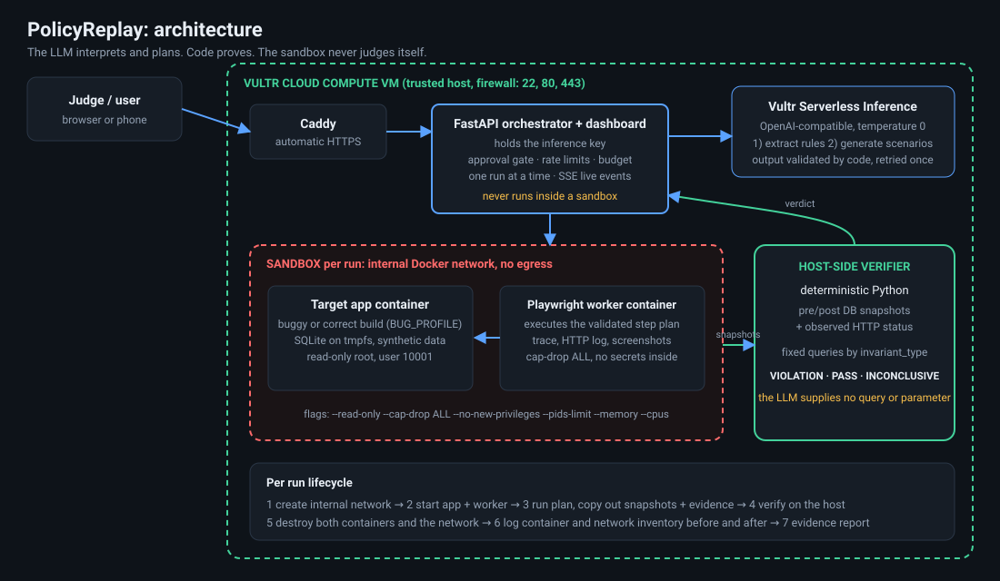

# PolicyReplay: Workflow Red Team

**The policy said no. The application said yes. PolicyReplay proved it.**

PolicyReplay turns a written business policy into adversarial browser tests, runs them against a disposable
e-commerce app inside a hardened sandbox on Vultr, and uses **deterministic Python** to decide whether the policy
was violated. The LLM interprets and plans; **code proves**. No model output can create a VIOLATION on its own.

- **Built for:** Vultr Agent Rush (3 to 8 Nov 2026), challenge 01 *Blast Radius Zero*: an agent that operates a browser, with every action inside an isolated sandbox on Vultr
- **Live demo:** https://139-84-216-65.sslip.io/ (runs on promotional cloud credit, so it may be taken offline)
- **License:** MIT

This repository is a hackathon build, not a maintained product.

## Results at a glance

Everything below is backed by files in [`docs/evidence/`](docs/evidence/), captured on the Vultr VM.

| | Result |
|---|---|
| Policies tested end to end | **5 of 5**, each with a planted bug in a buggy build and a control on a correct build |
| Reliability on the Vultr VM | **9 consecutive clean full runs** through the dashboard, 8 to 11 Nov 2026 (VM clock), **166 cases** in total |
| False positives on the correct build | **0** |
| Inconclusive verdicts | **0** |
| Environment cleanup | Confirmed in every case; no containers or run networks left behind |
| Sandbox re-run | All 14 command-line cases `OK` twice in a row; the second run took 1 min 53 s with no errors |
| Live model | `minimax-m3.1-flash` on Vultr Serverless Inference wrote all 5 rules and all 9 scenarios in the recorded engine run, and every one passed validation |

**On case counts.** A run has one scenario list and runs each scenario on both builds, so cases = 2 x scenarios.

| Runs | Scenarios | Cases | Buggy-build scenarios flagged VIOLATION |
|---|---|---|---|
| 7 | 9 | 18 | 5 |
| 2 | 10 (the live model wrote one extra scenario) | 20 | 6 |

There is one planted bug per policy, so 5 is the number of planted bugs. The `planted` column in `gate_report.txt`
counts violating *scenarios*, which is why the two 20-case runs show 6. The per-case matrix of the latest run is in
`latest_run_verdicts.txt`, and the dashboard's headline reports detection per policy.

## What it does

1. **Extract rules.** A Vultr-hosted model reads the policy text and returns structured rules. Every rule is
   checked by code: its `source_clause` must appear verbatim in the policy, its threshold must appear in that clause, and
   its `invariant_type` must come from a fixed list. Anything else is rejected, retried once, then replaced by a cached
   result that the UI labels **"replayed model output"**.
2. **Generate adversarial scenarios.** The model proposes scenarios and browser step plans from a fixed action
   vocabulary (`login`, `goto`, `fill`, `click`, `select`, `expect`). Code validates every plan and **recomputes the
   expected outcome itself**; the model's claim about it is ignored.
3. **Human approval.** Nothing runs until a person presses **Approve**.
4. **Execute in a sandbox.** For each approved scenario, a Playwright browser drives the target app, once on a
   **buggy build** and once on a **correct build** of the same image (`BUG_PROFILE`). The correct build is the
   false-positive control.
5. **Verify with code.** A host-side verifier compares pre-run and post-run database snapshots with the HTTP status the
   browser observed. Verdicts are **VIOLATION**, **PASS** or **INCONCLUSIVE**; it never guesses.
6. **Report and destroy.** An evidence report links every verdict to the policy clause, the browser actions,
   screenshots, observed state and sha256 hashes. The containers and network are then destroyed and the cleanup is logged.

### Policies covered

| ID | Policy | Planted bug (buggy build only) |
|---|---|---|
| P-01 | Refunds above INR 10,000 require manager approval (exactly 10,000 needs none) | The approval check is skipped |
| P-02 | Only administrators can modify user roles | Any staff role can change roles |
| P-03 | Shipped orders cannot be cancelled (shipped and delivered are both blocked) | The order-status check is skipped |
| P-04 | Discounts cannot exceed 30% (exactly 30% is allowed) | No maximum is enforced |
| P-05 | Customers cannot access another customer's order | The ownership check is skipped on the direct order URL |

## Verdict rules

| Verdict | Requires |
|---|---|
| **VIOLATION** | Preconditions verified, attempt observed in the HTTP log, and the database shows the invariant broken |
| **PASS** | Preconditions verified, proof the attempt was made (a blocked response: HTTP 403, or 409 and 422 where the app uses them), and the database shows the invariant upheld |
| **INCONCLUSIVE** | Anything else: attempt not logged, wrong seed state, unreadable database, or evidence that conflicts |

Controls built into the test set:

- the correct build must produce no violation (the false-positive control)
- boundaries are encoded and tested: exactly INR 10,000 and exactly 30% are allowed
- positive controls: an administrator changing a role, and cancelling an order that has not shipped, must both pass
- an unreadable database, a missing attempt, a wrong seed state or conflicting evidence must give INCONCLUSIVE, never PASS

## Architecture



| Layer | Implementation |
|---|---|
| Public entry | Caddy (automatic HTTPS) on the Vultr VM, reverse proxy to the orchestrator |
| Orchestrator + API | FastAPI on a **Vultr Cloud Compute** VM. It holds the inference key and never runs inside a sandbox |
| Inference | **Vultr Serverless Inference** (OpenAI-compatible endpoint), model `minimax-m3.1-flash`, temperature 0 |
| Target app | FastAPI, server-rendered, SQLite, `data-testid` on every control, one image with a `BUG_PROFILE` flag |
| Browser worker | Playwright + Chromium in its own container |
| Verifier | Python on the host, outside the sandbox, reading copied snapshots |
| Dashboard | One HTML file with vanilla JavaScript, served by the API: policy and rules with an approval gate, a live run (server-sent events) with collapsible case logs, and an evidence report with a results-by-policy matrix |

### Vultr services used

- **Vultr Cloud Compute VM** (High Performance, 4 vCPU / 8 GB, Ubuntu 24.04) as control plane, Docker host and public web app, behind a Vultr firewall group (ports 22, 80 and 443 only)
- **Vultr Serverless Inference** for all agent LLM calls (rule extraction and scenario generation)

### Why this model

Five hosted models were benchmarked with `scripts/model_bench.py` on this project's own validation, meaning a model counts
as passing only if its output survives every check above, not merely if it returns JSON. The benchmark ran while the
prompts covered three policies; the five-policy prompts were then validated with the chosen model only
(`docs/evidence/policy_engine.txt`).

| Model | Passed (of 2) | Average seconds per analysis |
|---|---|---|
| `minimax-m3.1-flash` (used) | 2 | 8.3 |
| `deepseek-v4.1-flash-1017` | 2 | 16.1 |
| `qwen3.8-flash-next` | 2 | 23.0 |
| `glm-5.3-flash` | 2 | 32.3 |
| `mimo-v2.6-flash` | 0 | 8.7 |

## Containment

Each run creates a Docker network with `--internal` (no egress) and two containers on it.

```
--read-only  --cap-drop ALL  --security-opt no-new-privileges  --user 10001
--pids-limit  --memory  --cpus   (tmpfs for /tmp and the app's /data)
```

Limits as configured, confirmed from `docker inspect` output that every run records (`docs/evidence/gate_report.txt`):

| Container | Processes | Memory | CPU | User |
|---|---|---|---|---|
| Target app | 128 | 256 MB | 0.5 | 10001 |
| Playwright worker | 256 | 1 GB | 1.0 | 10001 |

No Docker socket and no API keys inside any container. The only host mounts are the read-only plan file and the run's
evidence directory. Snapshots leave the app container through `docker exec`, and the verifier runs on the host. After
each run both containers and the network are removed, and the before and after inventory is recorded.

Tested with `python orchestrator/sandbox_run.py probe`, `stress` and `run`:

| Test | Result |
|---|---|
| Write to the root filesystem | Blocked: read-only file system |
| Reach the internet | Fails: network unreachable |
| Reach `169.254.169.254` | Fails: network unreachable (no route) |
| Secrets in the container environment | None (the only secret-like name is `GPG_KEY`, a public key ID shipped in the official Python image, which the probe whitelists explicitly) |
| Memory hog under a 128 MB limit | Killed, exit code 137, `OOMKilled` true |
| Fork loop under a 32-process limit | Capped by the process limit (exact count in `stress.txt`) |
| End of run | No containers or run networks left (`docker ps -a`, `docker network ls`) |

### Threat model and honest limits

- **Assumed hostile:** the target application and the browser, not a kernel-exploit attacker. Docker is **not** a complete
  boundary against kernel-level exploits; gVisor or a microVM would be the next step and is not implemented.
- **Chromium's own sandbox is off** (`--no-sandbox`), because it cannot run in a read-only, non-root, capability-free
  container. **The container is the boundary.** We did not add `SYS_ADMIN` to work around it.
- **Audit tables are app-maintained.** Verdicts for all five policies rely on rows the application under test writes
  (refunds and approvals, role changes, order status changes, discount changes, order views). Each verdict also requires
  the browser-observed HTTP status to agree, and conflicting evidence gives INCONCLUSIVE.
- **A PASS means the tested attempt was blocked.** It is not a compliance certification of the application, and five
  policies on one synthetic app say nothing about any other application.
- **The live model's output varies.** It sometimes writes an extra scenario (2 of the 9 recorded runs), so the case count
  moves between 18 and 20. Extra scenarios pass through the same validation as the others.
- The demo target is a synthetic app with synthetic data. There is no user-supplied target URL.
- The live view shows each case's browser steps after that case finishes, not click by click.
- Not built: PDF policy upload and a vision-model review of screenshots.

### Public demo safety

Fixed sample policy and fixed target app only; policy text capped at 4,000 characters; per-IP rate limits (20 analyses
and 10 runs per hour); one concurrent run; a configurable daily cap on model calls (after which cached output is used
and labeled); no endpoint returns the key or any credential.

## Evidence

Captured on 2026-11-12 (UTC) at commit `1880abc` on Linux 6.8.0-147-generic with Docker 29.9.3 and Python 3.12.3
(`docs/evidence/environment.txt`).

| File | What it shows |
|---|---|
| `environment.txt` | Commit, versions, model name and run mode of the captured system |
| `probe.txt` | Chromium launches in the hardened container; root write, internet and metadata access are blocked; no secrets in the environment |
| `stress.txt` | Memory hog killed (exit 137); fork loop capped; nothing left behind |
| `sandbox_run.txt`, `sandbox_run_second.txt` | All 14 command-line cases `OK` with cleanup confirmed, run twice in a row |
| `after_inventory.txt` | `docker ps -a` and `docker network ls` after the runs |
| `policy_engine.txt` | The live model's output: 5 rules and 9 scenarios, `source: model`, none unsupported |
| `gate_report.txt` | 9 consecutive clean runs, 166 cases, plus the recorded `docker inspect` hardening flags |
| `latest_run_verdicts.txt` | Per-case verdicts of the most recent dashboard run |
| `screenshots/` | The planted P-01 bug (refund issued) next to the correct build blocking it |

## Reproduce

Requirements: Ubuntu 24.04 (or similar), Docker, Python 3.12.

```bash
git clone https://github.com/kritantdev/policyreplay.git && cd policyreplay
python3 -m venv .venv && . .venv/bin/activate
pip install -r requirements-dev.txt

python orchestrator/sandbox_run.py build     # build the two images
python orchestrator/sandbox_run.py probe     # Chromium + containment probe
python orchestrator/sandbox_run.py stress    # memory hog and fork loop
python orchestrator/sandbox_run.py run       # all cases, buggy vs correct, in the sandbox
```

Run the API and dashboard (copy `.env.example` to `/etc/policyreplay.env`, add your key and model first):

```bash
set -a; source /etc/policyreplay.env; set +a
PR_RUN_MODE=docker uvicorn orchestrator.main:app --host 127.0.0.1 --port 8000
```

Without a key the system still runs, using labeled replayed model output. For a public deployment, put a reverse proxy
with TLS in front. The server-sent events need response buffering off; with Caddy:

```
your-host.example.com {
    reverse_proxy 127.0.0.1:8000 {
        flush_interval -1
    }
}
```

[`deploy/`](deploy/) holds the systemd unit used on the VM and a short guide to updating the live server and changing the
daily model-call cap.

```bash
python -m pytest verifier/tests worker/tests orchestrator/tests dashboard/tests     # add PR_NO_SANDBOX=1 when running as root
(cd target_app && python -m pytest tests)
python scripts/gate_report.py          # reliability gate and containment evidence from the runs on this machine
```

## Repository layout

```
orchestrator/   FastAPI control plane, LLM client, policy engine, sandbox runner
target_app/     disposable e-commerce app with BUG_PROFILE and its Dockerfile
worker/         Playwright worker (validated step plans only) and its Dockerfile
verifier/       deterministic verifier, schemas, fixtures
dashboard/      single-page UI and its browser tests
policies/       the fixed sample policy
scripts/        model benchmark, auth check, gate report
deploy/         systemd unit and deployment guide
docs/           architecture diagram and captured evidence
```

## Positioning

PolicyReplay is a workflow tester for e-commerce policies. It combines policy-to-test compilation, adversarial browser
execution and independent, clause-linked verification in one workflow. It is a demonstration and testing tool, not a
compliance certification system, and it does not claim to work on arbitrary web applications.
